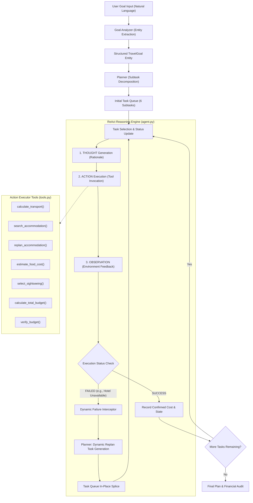

# ReAct-Based Intelligent Travel Planning Agent with Dynamic Replanning

**Unit 2: Reasoning, Planning and Decision-Making (CO-2)**  
**Student Name:** Vedant Sattejkumar Kirange  
**Roll No:** 55  
**PRN / Student ID:** ADT23SOCB1294  
**Course:** Reasoning, Planning and Decision Making  
**Language:** Python 3.10+ (Standard Libraries)  
**Execution Environment:** Local Python / 100% Offline (No Paid API Keys Required)  
**Repository:** [https://github.com/vedantvk12/React-Reasoning-Agent.git](https://github.com/vedantvk12/React-Reasoning-Agent.git)

---

## Executive Summary

Autonomous agents operating in complex environments must perform goal decomposition, reason about environmental constraints, interact with external systems via actions, and perceive intermediate feedback. This project implements an intelligent autonomous reasoning agent utilizing the **ReAct (Reason + Act)** paradigm. 

The agent accepts an unstructured, high-level natural language objective, extracts essential travel constraints, decomposes the goal into a deterministic pipeline of subtasks, executes each task through concrete Python tools, observes execution feedback, and performs **dynamic replanning** when runtime assumptions fail (such as a fully booked hotel). The entire system operates deterministically using local catalogs without requiring third-party API keys or paid services.

---

## System Architecture



---

## 1. Goal Chosen and Sub-Tasks Produced

### Selected Objective
> **"Plan a 2-day trip to Goa for 2 people within a budget of ₹10,000, including transportation, accommodation, food, and sightseeing."**

### Parameter Extraction (Goal Analyzer)
The `GoalAnalyzer` component parses the raw natural language input and extracts key parameters into a strongly-typed `TravelGoal` dataclass:

| Parameter | Extracted Value | Description & Constraint Role |
| :--- | :--- | :--- |
| **Destination** | `Goa` | Destination location for logistics and activity catalogs |
| **Duration** | `2 Days` | Stay length determining hotel nights and daily meal budgets |
| **Number of People** | `2 People` | Party size sizing railway tickets, hotel occupancy, and meals |
| **Budget Ceiling** | `₹10,000` | Hard financial upper limit enforced during verification |

### Subtasks Produced by the Planner
To satisfy all user requirements and enforce financial feasibility, the `Planner` decomposes the objective into six ordered subtasks:

| Step # | Subtask Name | Bound Python Action | Initial Target / Assumption | Justification & Goal Contribution |
| :---: | :--- | :--- | :--- | :--- |
| **1** | Calculate transportation expenses | `calculate_transport()` | Konkan Express AC Sleeper (Round-trip) | Establishes round-trip travel for the group before selecting lodging. |
| **2** | Find suitable accommodation | `search_accommodation()` | 3-Star Resort: "Sunset Beach Resort" (₹3,000) | Secures lodging for 2 nights; primary candidate subject to real-time availability. |
| **3** | Estimate food expenses | `estimate_food_cost()` | Local Goan Cuisine & Shacks (₹750/person/day) | Provides realistic daily meal expenses across the entire party duration. |
| **4** | Select sightseeing activities | `select_sightseeing()` | Fort Aguada + Beaches + Scooter Rental | Selects top regional attractions and local mobility to complete the trip itinerary. |
| **5** | Calculate total expenses | `calculate_total_budget()` | Aggregate confirmed costs | Consolidates all verified subtask expenditures into an exact sum. |
| **6** | Verify budget compliance | `verify_budget()` | Limit check $\le$ ₹10,000 | Evaluates total expenses against ceiling and calculates emergency reserves. |

---

## 2. Code Architecture & Project Structure

The project is structured in a clean, modular Python architecture:

```
React-Reasoning-Agent/
├── models.py            # Dataclasses: TravelGoal, Task, ActionResult, ExecutionStep, TravelPlan
├── planner.py           # GoalAnalyzer entity parser and subtask decomposition Planner
├── tools.py             # Action Executor tools and offline local catalogs
├── agent.py             # Core ReAct reasoning loop, failure detection, and replanning
├── main.py              # CLI entry point, execution runner, and report generator
├── app.py               # Streamlit interactive web dashboard
├── requirements.txt     # Project dependencies
├── .gitignore           # Git ignore configuration
├── outputs/
│   ├── execution_trace.txt   # Exported raw Thought / Action / Observation log
│   └── plan_summary.json     # Machine-readable JSON summary of the plan
└── tests/
    ├── __init__.py
    └── test_agent.py    # Unit tests for analyzer, planner, tools, and agent
```

### Key Implementation Snippets

#### Data Models (`models.py`)
```python
@dataclass
class ActionResult:
    success: bool
    action_name: str
    message: str
    cost: float = 0.0
    data: Dict[str, Any] = field(default_factory=dict)
    failure_reason: Optional[str] = None

@dataclass
class Task:
    task_id: str
    name: str
    action: str
    params: Dict[str, Any] = field(default_factory=dict)
    status: TaskStatus = TaskStatus.PENDING
    cost: float = 0.0
    result: Optional[ActionResult] = None
    is_replanned: bool = False
```

#### Core ReAct Loop with Dynamic Replanning (`agent.py`)
```python
while task_index < len(current_tasks):
    task = current_tasks[task_index]
    
    # 1. THOUGHT
    thought = self._generate_thought(task)
    
    # 2. ACTION
    result = self._execute_action(task.action, task.params)
    
    # 3. OBSERVATION
    observation = result.message
    self.trace_history.append(ExecutionStep(...))
    
    # 4. FAILURE DETECTION & DYNAMIC REPLANNING
    if not result.success:
        task.status = TaskStatus.FAILED
        if task.action == "search_accommodation":
            plan.replanning_occurred = True
            plan.failed_task = task
            plan.replanning_reason = result.failure_reason
            
            # Dynamically instantiate replacement task
            replanned_task = Planner.create_replanned_accommodation_task(task, self.goal)
            plan.replanned_task = replanned_task
            
            # Splice replacement task into active queue
            current_tasks.insert(task_index + 1, replanned_task)
            task_index += 1
            continue
        else:
            break
            
    task.status = TaskStatus.SUCCESS
    task_index += 1
```

---

## 3. Printed Thought / Action / Observation Trace

Below is the complete, untruncated execution trace generated from the live system run (also preserved in `outputs/execution_trace.txt`):

```text
THOUGHT:
I need to arrange transportation before selecting accommodation.
ACTION:
calculate_transport()
OBSERVATION:
Transportation estimated at ₹2,000 (Konkan Express (AC 3-Tier Sleeper) round-trip for 2 people at ₹1,000 each).

THOUGHT:
I will now check accommodation availability.
ACTION:
search_accommodation()
OBSERVATION:
Selected hotel 'Sunset Beach Resort' is unavailable. (Fully booked for the selected dates due to peak weekend season.)

THOUGHT:
The original accommodation assumption is incorrect. I need to revise the plan.
ACTION:
replan_accommodation()
OBSERVATION:
Alternative guesthouse 'Palm Breeze Budget Guesthouse' successfully selected for ₹2,000. Includes AC Double Room near beach with verified availability.

THOUGHT:
Accommodation is secured. Now I should estimate food expenses.
ACTION:
estimate_food_cost()
OBSERVATION:
Food expenses estimated at ₹3,000 (2 days x 2 people @ ₹750/person/day for Local Goan Beach Shacks & Authentic Thalis).

THOUGHT:
Food costs are estimated. Next, I will select sightseeing activities.
ACTION:
select_sightseeing()
OBSERVATION:
Sightseeing and local scooter rental estimated at ₹1,200. Selected: Fort Aguada, Calangute/Baga beaches, Old Goa churches & 2-day scooter rental.

THOUGHT:
All individual trip components have been calculated. I will now aggregate the total trip expenses.
ACTION:
calculate_total_budget()
OBSERVATION:
Total expenses calculated at ₹8,200 (Transport: ₹2,000, Accommodation: ₹2,000, Food: ₹3,000, Sightseeing: ₹1,200).

THOUGHT:
I must now verify whether the total calculated expenses fit within the user's budget limit of ₹10,000.
ACTION:
verify_budget()
OBSERVATION:
Plan is within budget. Total ₹8,200 is within limit of ₹10,000. Remaining savings buffer: ₹1,800.
```

---

## 4. Dynamic Replanning Case Study

Dynamic replanning enables autonomous systems to withstand uncertain and changing environments. Rather than crashing or blindly proceeding with invalid parameters, the agent perceives the failure, reasons about its implications, and dynamically updates its task queue.

### A. What Went Wrong?
In Step 2, the agent attempted to book lodging at the primary target resort: **"Sunset Beach Resort"** with an estimated cost of ₹3,000. Upon querying the inventory tool `search_accommodation()`, the hotel was marked unavailable because all rooms were fully booked due to peak weekend demand in Goa.

### B. How Did the Agent Identify the Problem?
The tool returned an `ActionResult` with:
- `success = False`
- `cost = 0.0`
- `failure_reason = "Fully booked for the selected dates due to peak weekend season."`

During the ReAct loop's post-action evaluation stage, the agent evaluated `result.success`. Noticing `False`, it flagged the step as `FAILED`, recorded the specific failure rationale, and intercepted the failure before any downstream calculations were executed.

### C. What Did the Agent Change?
Instead of restarting the entire plan and voiding the completed transportation booking (₹2,000), the agent reasoned:
> *"The original accommodation assumption is incorrect. I need to revise the plan."*

The agent engaged the `Planner.create_replanned_accommodation_task()` routine, which constructed an alternative task targeting **"Palm Breeze Budget Guesthouse"**. This task was spliced into the queue immediately following the failed step. The agent then invoked `replan_accommodation()`, securing verified double AC accommodation for ₹2,000 (saving ₹1,000 compared to the original estimate).

### D. Final Result & Impact
Once accommodation was secured, execution resumed smoothly for food estimation, sightseeing selection, and total budget aggregation. The final cost totaled **₹8,200**, leaving an unallocated savings buffer of **₹1,800** within the ₹10,000 limit.

### Before vs. After Replanning Comparison

| Component | Original Plan (Assumed) | Revised Plan (Replanned) | Status / Financial Impact |
| :--- | :--- | :--- | :--- |
| **Transportation** | AC Sleeper Train (₹2,000) | AC Sleeper Train (₹2,000) | Preserved without re-execution |
| **Accommodation** | Sunset Beach Resort (₹3,000) | Palm Breeze Guesthouse (₹2,000) | **Switched to budget guesthouse; Saved ₹1,000** |
| **Food & Dining** | Local Goan Shacks (₹3,000) | Local Goan Shacks (₹3,000) | Executed as planned |
| **Sightseeing** | Fort Aguada & Scooter (₹1,200) | Fort Aguada & Scooter (₹1,200) | Executed as planned |
| **Total Expenses** | ₹9,200 (Projected) | **₹8,200 (Final Actual)** | **Expenditure reduced by ₹1,000** |
| **Budget Ceiling** | ₹10,000 | ₹10,000 | Respected with ₹1,800 savings buffer |

---

## 5. Three Lines: Where ReAct Helped and Where It Struggled

1. **ReAct helped by breaking a complex goal into smaller tasks and executing them step by step.**
2. **ReAct helped by observing execution failures and dynamically modifying the plan instead of blindly following the original plan.**
3. **ReAct struggled with limited decision-making flexibility because the project uses predefined Python tools and simulated travel data rather than real-world live information.**

---

## 6. Installation & Execution Guide

### Prerequisites
- Python 3.10 or higher
- Git

### 1. Clone the Repository
```bash
git clone https://github.com/vedantvk12/React-Reasoning-Agent.git
cd React-Reasoning-Agent
```

### 2. Run the Command-Line Agent (CLI)
Run the agent using standard Python with zero third-party dependencies:
```bash
python main.py
```

To run with a custom goal:
```bash
python main.py --goal "Plan a 3-day trip to Goa for 2 people within a budget of 15,000"
```

To run without simulated failure (demonstrating normal flow):
```bash
python main.py --no-fail
```

### 3. Run the Unit Test Suite
Verify that all unit tests pass:
```bash
python -m unittest discover tests
```

### 4. Launch the Interactive Web Dashboard (Optional)
Install Streamlit and launch the dashboard:
```bash
pip install streamlit
streamlit run app.py
```

---

## Academic Verification
- **Student:** Vedant Sattejkumar Kirange (Roll No: 55 | PRN: ADT23SOCB1294)
- **Course:** Reasoning, Planning and Decision Making (Unit 2 CO-2)
- **Artifacts Generated:** `outputs/execution_trace.txt`, `outputs/plan_summary.json`
